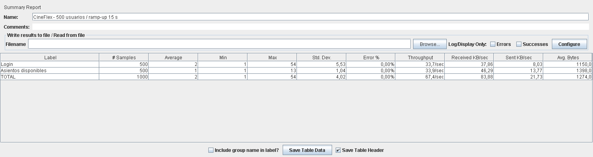

# Evidencias de ejecución

Fecha de validación: 15 de octubre de 2026. Entorno local Windows, Node.js 24.15.0, Chrome con Selenium WebDriver, SQLite en memoria.

| Verificación | Resultado local |
|---|---|
| Supertest | 2 escenarios de integración aprobados; incluyen 10 compras concurrentes con una venta y nueve conflictos |
| Postman / Newman | 7 peticiones, 22 aserciones, cero fallos |
| SLA de cartelera en Newman | 5 ms en la ejecución inicial; umbral exigido menor a 300 ms |
| Selenium / POM | 19 de 19 casos aprobados |
| Auditoría de dependencias de producción | 0 vulnerabilidades reportadas |

Las mediciones locales no son una garantía de tiempos en internet o en producción. Las pruebas de UI levantan datos nuevos y no alteran la base de la demo.

## JMeter 5.6.3

Ejecutado contra el mock en localhost con Java 21.0.12, procesador Intel Core i5-13420H (12 procesadores lógicos) y 7,7 GiB de RAM física. JMeter y servidor compartían equipo.

| Muestra | Cantidad | Errores | Promedio | p95 | Throughput |
|---|---:|---:|---:|---:|---:|
| Login | 500 | 0 % | 2,614 ms | 3 ms | 33,71/s |
| Asientos disponibles | 500 | 0 % | 1,478 ms | 2 ms | 33,90/s |
| Total | 1.000 | 0 % | 2,046 ms | 3 ms | 67,42/s |

Fuente: [estadísticas del dashboard de JMeter](carga-statistics.json), [muestras JTL](carga.jtl). El resumen de consola calcula 66,7/s en el intervalo global de 15 segundos; el dashboard calcula 67,42/s entre muestras. No son dos ejecuciones diferentes.

La imagen se obtuvo renderizando el componente Swing SummaryReport de JMeter con el JTL real, en modo headless. No se inventaron ni sobrescribieron resultados. El grupo configura 500 hilos, ramp-up 15 s y una iteración por usuario; con consultas tan breves la concurrencia observada es menor que 500. Se requiere una prueba sostenida adicional para afirmar 500 peticiones simultáneas.

## GitHub Actions

La [primera ejecución de CI](https://github.com/KenCruz48/qa-cineflex-project/actions/runs/38744328203) del commit `1d4e494` terminó correctamente en GitHub: Supertest, Newman y Selenium. El badge del README muestra el estado de la rama más reciente.

## Cierre de validación del 21 de octubre de 2026

El rediseño de ingreso, cartelera, reserva y ticket está publicado. La [ejecución del rediseño](https://github.com/KenCruz48/qa-cineflex-project/actions/runs/38746423193) terminó aprobada. Se agregó `npm run qa` para repetir todas las suites con servidores aislados y `iniciar-cineflex.cmd` para arrancar desde Windows. Las métricas de carga anteriores conservan su fecha y no se presentan como mediciones nuevas.

El único entregable que depende del equipo es la grabación y publicación del video de sustentación. La guía de tiempos está en `docs/sustentacion.md`.
